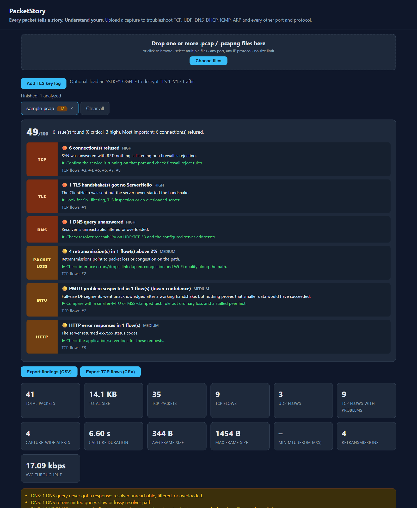

# PacketStory

**Every packet tells a story. Understand yours.**

PacketStory turns `.pcap` / `.pcapng` captures into a ranked, plain-English troubleshooting report: what is
broken, why it probably is, and what to do next. It runs entirely on your machine. Captures are never uploaded.

**[Download for Windows](https://github.com/prawinnetsecdevops-creator/PacketStory/releases/latest/download/PacketStory-Portable.zip)**
&middot; [Project page](https://prawinnetsecdevops-creator.github.io/PacketStory/)

## What is it?

When a website is slow, a call drops or an app can't connect, the evidence is usually in a **packet capture**,
a recording of everything that crossed the network. Reading one normally takes years of experience.
PacketStory reads it for you and explains, in plain English, what went wrong, the likely reason and what to try next.

1. **Drop in a capture** (`.pcap` / `.pcapng`, one or many files).
2. **Get the story:** a 0-100 health score and a short list of problems, worst first.
3. **Know what to do:** every problem comes with a suggested next step and the connections involved.



## Quick start (Windows, no install)

1. Download `PacketStory-Portable.zip` from the [latest release](https://github.com/prawinnetsecdevops-creator/PacketStory/releases/latest).
2. Extract it anywhere and run `PacketStory\PacketStory.exe` (no Python needed).
3. Drop one or more capture files into the window.

Windows SmartScreen may warn about an unsigned app on first run: choose **More info > Run anyway**.

## Features

- **Executive summary:** a 0-100 health score and issues ranked critical to low, each with a recommended action and the affected flows.
- **Every port and protocol:** TCP flows, UDP, DNS (over UDP and TCP), DHCP, ICMP/ICMPv6, ARP, and other IP protocols.
- **TCP health:** handshake failures, refused connections, resets, retransmissions, zero windows, duplicate ACKs, RTT, server response time.
- **MTU and size:** MSS-implied MTU, ICMP "fragmentation needed", IP fragmentation, PMTU black-hole detection, size distribution.
- **TLS:** SNI, ALPN, TLS 1.3 detection, missing ServerHello, deprecated versions, alerts, and, with an SSLKEYLOGFILE, decrypted certificates, alerts, HTTP status and DNS-over-TLS queries.
- **Multiple captures:** analyze several files, compare them side by side, or merge them into one timeline (packets seen at several capture points are counted once, whatever their TTL).
- **Export:** findings and TCP flows as CSV.

## Run from source

Requires Python 3.10+. There are no required third-party dependencies; `cryptography` is optional and only
needed for TLS decryption and certificate inspection.

```powershell
python app.py                    # desktop window (Edge or Chrome app mode)
python analyzer_backend.py       # web server at http://127.0.0.1:8000
python analyzer_backend.py a.pcap b.pcap   # CLI: print merged JSON
python -m unittest discover -s tests -v    # tests
```

API: `POST /api/analyze` (raw capture bytes), `POST /api/analyze/merge` (concatenated captures plus an
`X-File-Sizes` header), `POST /api/keylog` (an SSLKEYLOGFILE; pass the returned id as `X-Keylog-Id` on the
analyze calls), `GET /api/packets?session=&flow=&offset=&limit=` (paged packet rows of a flow, using the
`session` id in the analysis result), `GET /api/health`.

## Decrypting TLS (optional)

Set the `SSLKEYLOGFILE` environment variable before starting a browser or client, capture the traffic, then
load the key log next to the capture: **Add TLS key log** in the UI, or
`python analyzer_backend.py capture.pcap --keylog keys.log` on the command line. PacketStory then shows
certificates (with expiry and name-mismatch checks), encrypted alerts, HTTP status codes inside TLS, and the
DNS queries inside DNS-over-TLS. This needs the optional `cryptography` package
(`pip install cryptography`, already included in the portable zip); without it everything else still works.

## Build the portable zip

```powershell
pip install pyinstaller cryptography
build_exe.bat        # produces PacketStory-Portable.zip
```

Pushing a tag such as `v2.0.0` builds the zip on GitHub and attaches it to a release automatically
(see `.github/workflows/release.yml`).

## Road map

- **Done:** ranked reports, TCP/UDP/DNS/DHCP/ICMP/ARP analysis, TLS insight with optional decryption, DNS-over-TLS, multi-file merge, Windows portable app.
- **Next:** shareable HTML/PDF reports, a side-by-side comparison view, clearer visual connection timelines.
- **Ideas:** QUIC/HTTP/3 and HTTP/2 insight, voice/video quality (RTP), Linux and macOS builds, a code-signed installer.

Ideas and bug reports are welcome in [Issues](https://github.com/prawinnetsecdevops-creator/PacketStory/issues).

## Limitations

- Decryption covers TLS 1.3 and TLS 1.2 AEAD suites (AES-GCM, ChaCha20-Poly1305) only. CBC suites, TLS 1.3
  KeyUpdate, 0-RTT early data and QUIC are not decrypted, and encrypted HTTP/2 is not decoded.
- Without a key log, TLS 1.3 certificates and alerts stay hidden. DNS-over-TLS is still identified
  (resolver, SNI, handshake), but its queries need keys.
- Merging removes a packet seen at several capture points only when the IP payload is identical. NAT that
  rewrites addresses, ports or checksums between capture points defeats this.
- Uploads have no size limit, but they are written to a temporary file, so free disk space is required.
  Analysis results for the last 8 captures are kept in memory for paging; a very large capture needs RAM for
  its packet records. Set `PACKETSTORY_MAX_UDP_FLOWS` to change the UDP flow cap (default 1,000,000).

## License

PacketStory is licensed under the MIT License. See the [LICENSE](LICENSE) file for details.
